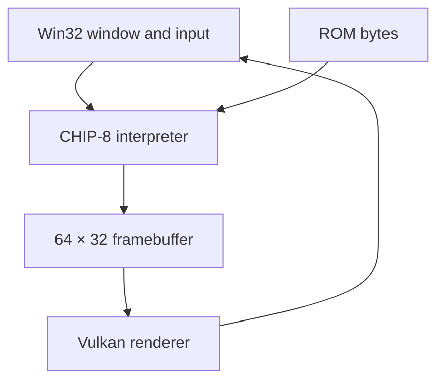

# CHIP-8 Emulator — C++ / Vulkan / Win32

A learning project implementing a CHIP-8 interpreter, a Vulkan display renderer,
and native Windows keyboard input. This branch contains the emulator; the repository's
`main` branch currently contains an earlier Pong/Vulkan project.

## What is implemented

- A 4 KB memory model, sixteen 8-bit registers, a stack, and a 64 × 32 framebuffer.
- Opcode dispatch through member-function tables, including arithmetic, jumps, calls,
  sprite drawing, keypad operations, and register/memory transfers.
- XOR sprite drawing with collision reporting and screen-edge wrapping.
- Keyboard mapping from a PC keyboard to the hexadecimal CHIP-8 keypad.
- A Vulkan renderer connected to a Win32 window and the emulated framebuffer.
- Delay and sound timer registers. Audible sound output is **not verified in this branch**.

This is a work in progress. It does not claim complete CHIP-8 compatibility or
conformance to a particular interpreter's quirks. [Known limitations](docs/validation.md)
are part of the project, rather than hidden behind an accuracy claim.

## Source tour

| Area | Start reading here | Responsibility |
| --- | --- | --- |
| Interpreter | [chip8Emulator.cpp](src/emulator/chip8Emulator.cpp) | Decode and execute instructions; update emulated state |
| State | [chip8Emulator.h](src/emulator/chip8Emulator.h) | Registers, RAM, stack, timers, framebuffer and opcode tables |
| Application | [main.cpp](src/main.cpp) | Create the window, choose a ROM, drive execution and rendering |
| Graphics | [vk_renderer.cpp](src/renderer/vk_renderer.cpp) | Vulkan resources and presentation |
| Input | [win32_platform.cpp](src/windows_platform/win32_platform.cpp) | Windows messages and keypad mapping |



## Build and run on Windows

The checked-in project uses Visual Studio 2022's `v143` toolset, C++17, the Vulkan
SDK, and a restored CppWinRT NuGet package. It has **not** been rebuilt on a clean
Windows machine during this documentation update.

1. Install Visual Studio 2022 with Desktop development with C++ and the Vulkan SDK.
2. Clone and select the emulator branch:

   ```powershell
   git clone --branch Chip8-Rendering https://github.com/DVecc/Chip8Emulator.git
   cd Chip8Emulator
   ```

3. Open `Chip8Emulator.sln` and restore its NuGet packages. Select **Debug / x64**.
4. The existing project references the original developer's absolute paths. In project
   properties, replace the GLM include location with `$(ProjectDir)glm` (the checked-in
   `glm/` folder is beneath it), Vulkan includes with `$(VULKAN_SDK)\Include`, and
   Vulkan library directories with `$(VULKAN_SDK)\Lib`. Keep inherited values.
   Check the renderer's includes if your GLM include layout differs.
5. In `src/main.cpp`, update `vk_compile_shader` to your SDK's `glslc.exe` path and
   replace the two absolute shader input/output paths with paths for your checkout.
   Set the debugger's working directory to `$(ProjectDir)` so the renderer can find
   `src/shaders/vert.spv`, `src/shaders/frag.spv`, and ROM files.
6. Build and run. `main.cpp` currently loads `src/Rush Hour [Hap, 2006].ch8`.
   To choose another ROM, edit the argument to `LoadROM` and rebuild. Run only trusted,
   appropriately licensed ROMs; the loader is not hardened against malformed input.

The old committed executable has been removed from the proposed branch. A verified
downloadable release and gameplay recording are follow-up work, not current deliverables.

## Keyboard mapping

| PC keys | CHIP-8 keys |
| --- | --- |
| `1 2 3 4` | `1 2 3 C` |
| `Q W E R` | `4 5 6 D` |
| `A S D F` | `7 8 9 E` |
| `Z X C V` | `A 0 B F` |

Release **Escape** to exit. Individual ROM controls vary.

## Engineering notes

The project separates emulated state, rendering and Windows input into distinct source
areas. The framebuffer is the boundary between instruction execution and display output.
The dispatch table is a useful point to discuss decoding tradeoffs and unsupported opcodes.

The next technical improvement should be separating 60 Hz timer updates from instruction
execution, then adding headless opcode tests. A fancy renderer is not evidence of correct
instruction behavior. See [the verification and demo checklist](docs/validation.md).

## Attribution

GLM and other dependencies retain their original notices. Bundled ROM authorship and
redistribution permissions need to be checked before packaging a public binary release.
This README and source-tour documentation were prepared with AI assistance and checked
against the committed source. No new emulator functionality is claimed by this update.
