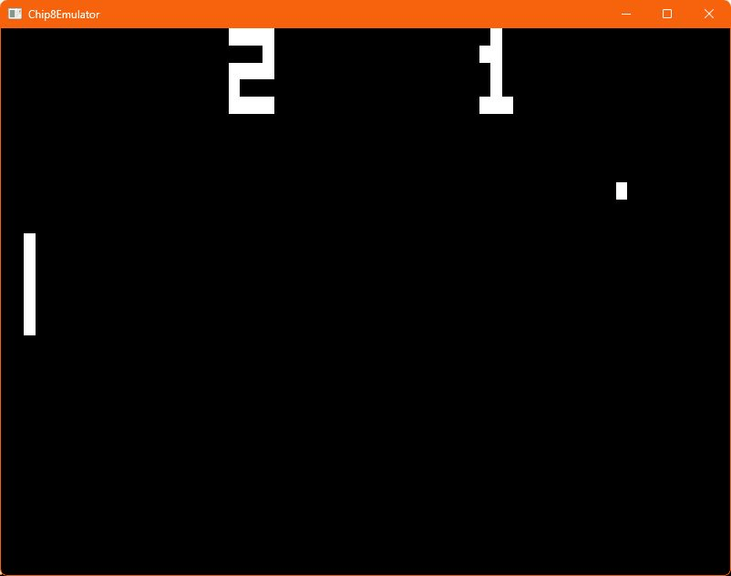

# CHIP-8 Emulator

[](https://github.com/DVecc/Chip8Emulator/actions/workflows/windows.yml)

A Windows CHIP-8 emulator built with **C++17, Vulkan, Win32 and miniaudio**. It executes CHIP-8 instructions, draws a 64 x 32 framebuffer through a Vulkan texture, reads the hexadecimal keypad from a PC keyboard, and generates sound.

**[Download the Windows x64 preview](https://github.com/DVecc/Chip8Emulator/releases/tag/v0.1.0)** · [Build and test results](docs/validation.md) · [Screenshot](docs/media/pong-gameplay.jpg)



Actual gameplay captured from the Windows build. The 6.2-second recording is silent; audio works in the emulator. This is a learning project with partial CHIP-8 compatibility, rather than a complete interpreter implementation.

## Try the Windows build

1. Download and extract the ZIP from the release page.
2. Keep the `shaders` folder beside `Chip8Emulator.exe`.
3. Drag your own trusted `.ch8` ROM onto the executable, or launch it from PowerShell:

   ```powershell
   & .\Chip8Emulator.exe 'C:\path\to\game.ch8'
   ```

Requires Windows x64 and a graphics driver with Vulkan support. The downloadable CMake build links the Microsoft C++ runtime statically; Visual Studio and the Vulkan SDK are not required to run it. ROMs are not included. The preview executable is unsigned.

## What the project demonstrates

- **Interpreter implementation:** 4 KB memory, sixteen 8-bit registers, stack, opcode dispatch tables, ROM loading and built-in font sprites.
- **Graphics programming:** Vulkan instance/device setup, swapchain presentation, texture uploads, nearest-neighbor sampling and Win32 window integration.
- **Emulated display and input:** XOR sprite drawing, collision reporting, edge wrapping and a PC-to-CHIP-8 keypad mapping.
- **Timing and sound:** ten instructions per approximately 60 Hz frame, one timer tick per frame, and miniaudio tone generation.
- **Build and verification:** CMake, build-time shader compilation, core regression checks, Windows CI and a ROM-free packaging script.

The interpreter owns the framebuffer; the renderer consumes its pixels. Win32 input is translated through a small input interface, keeping opcode execution separate from window messages and Vulkan setup.

## Build from source

Requires Visual Studio 2022 with **Desktop development with C++**, a Windows SDK, CMake 3.22 or newer, and the Vulkan SDK including `glslc`. GLM and miniaudio are vendored with their original license notices.

From the repository root, set `VULKAN_SDK` to your installed SDK directory. This is the version used for the local build:

```powershell
$env:VULKAN_SDK = 'C:\VulkanSDK\1.4.309.0'
cmake -S . -B out -G 'Visual Studio 17 2022' -A x64
cmake --build out --config Release
ctest --test-dir out -C Release --output-on-failure
& .\out\Release\Chip8Emulator.exe 'C:\path\to\game.ch8'
```

ROM paths are required and may be absolute or relative to the invoking directory. Shader lookup uses the executable directory. Shaders compile during the build and are copied beside the executable automatically.

The existing Visual Studio solution also supports Release / x64 using `$(ProjectDir)` and `$(VULKAN_SDK)` paths. CMake is the primary build and CI workflow; x86 is not verified.

To create the same package locally:

```powershell
.\scripts\package-release.ps1
```

The script copies an explicit list of runtime files, dependency notices and instructions, then writes a ZIP and SHA-256 checksum under `releases/`.

## Source tour

- [Interpreter](src/emulator/chip8Emulator.cpp): opcode execution, memory, sprite drawing, timers and sound.
- [Renderer](src/renderer/vk_renderer.cpp): Vulkan resources, framebuffer uploads and presentation.
- [Windows platform](src/windows_platform/win32_platform.cpp): window lifecycle and keyboard messages.
- [Application](src/main.cpp): ROM selection and execution loop.
- [Core tests](tests/core_tests.cpp): small authored instruction programs checking behavior without a third-party ROM.

## Controls

```text
PC keyboard    CHIP-8 keypad
1 2 3 4        1 2 3 C
Q W E R        4 5 6 D
A S D F        7 8 9 E
Z X C V        A 0 B F
```

Release Escape to exit. Individual games use different controls.

## Verification and current scope

Local Release builds and CTest pass. Regression checks cover font drawing, XOR collision reporting, timer separation, key-wait behavior and oversized-ROM rejection. Pong gameplay and the Rush Hour title screen were observed in the real application; working audio was confirmed by the developer.

Windows is the only supported platform. Complete CHIP-8 compatibility, SCHIP/XO-CHIP, configurable interpreter quirks and precise timing under load are not implemented. The display stretches with the window, and malformed-ROM checks are incomplete. See [the validation record](docs/validation.md) for the test scope and remaining engineering work.

The Windows CI builds, runs the core checks and produces a downloadable artifact. It does not perform GPU gameplay or audio verification on the hosted runner.

## Dependencies and ROMs

[Third-party notices](docs/THIRD_PARTY_NOTICES.md) cover GLM and miniaudio. No ROMs are packaged with the executable or tracked in the current source tree. Local ROMs are ignored; older commits and archived branches still contain historical files.

Recent build fixes, tests, packaging and documentation were developed with AI assistance and checked through local compilation, regression checks and gameplay capture.
